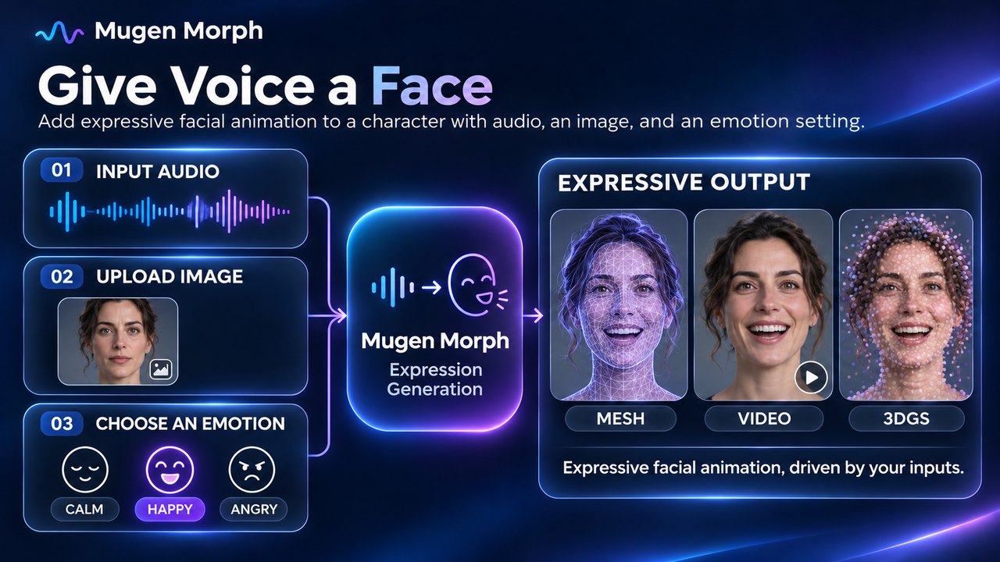
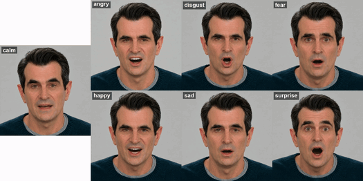
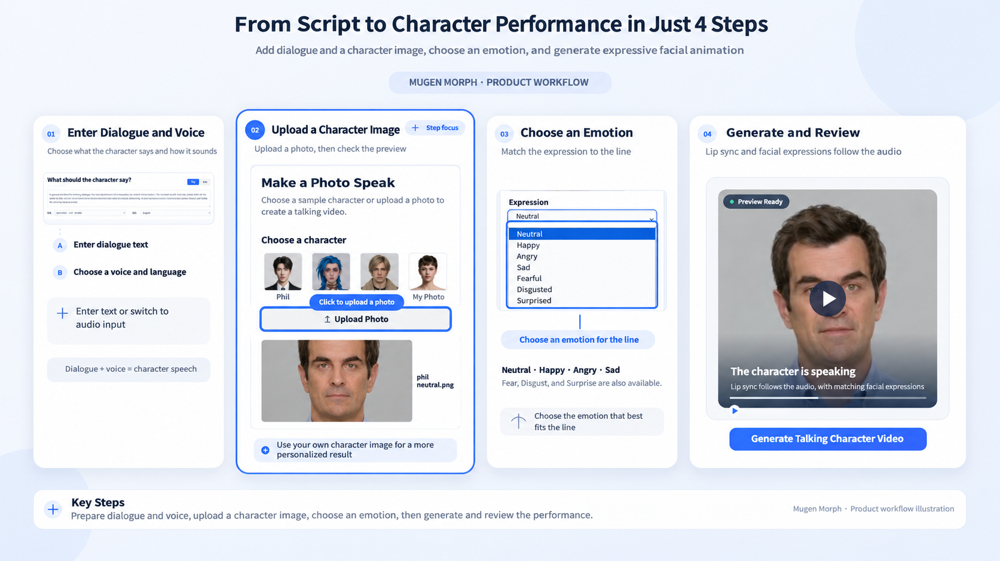
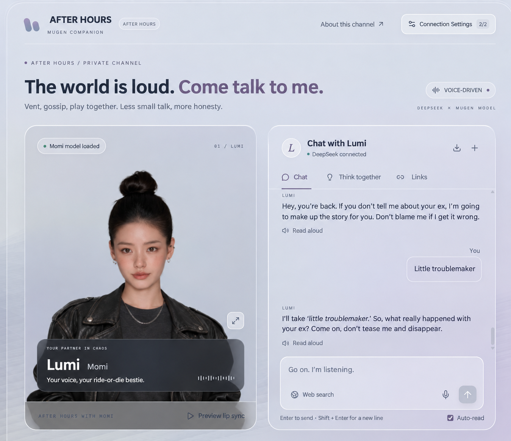
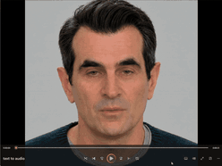
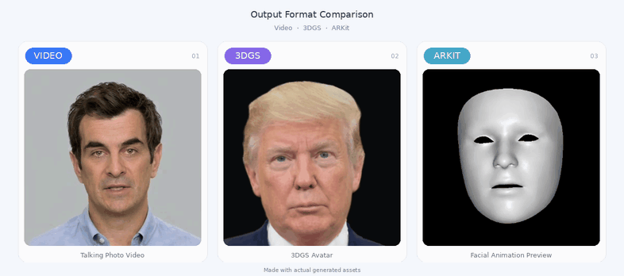

# Mugen Morph: Audio-driven character animation and a conversational-avatar workflow

**Sumeru AI | Workflow discussion**

I’m sharing a look at Mugen Morph and an application idea I’d like to discuss: using audio-driven facial animation as one component of a conversational character. The interesting engineering question is how to connect speech, character performance, and presentation while measuring each stage separately.

Mugen Morph takes character material and audio to produce synchronized lip movements and facial expressions. The source workflow covers character images, Mesh-based 3D digital humans, and 3D Gaussian Splatting (3DGS) avatars. The conversational example below is a proposed architecture, rather than a completed integration or a released code sample.

> 
>
> **Mugen Morph: Bringing a character’s lip movements and expressions to life with audio**

## From audio to facial performance

The basic workflow starts with a character image and an audio clip, followed by an emotion selection. Mugen Morph generates lip movements and facial motion from the audio and applies that performance to the character.

For evaluation, I would keep the character and audio fixed while changing the emotion. That makes it easier to examine mouth synchronization alongside the eyes, brows, and other expression changes. The same distinction matters for NPC dialogue, character-led explainers, and virtual presenters: an animated mouth alone does not tell us how readable the performance will be.

> 
>
> **From character images and audio to expressive facial animation**

## A conversational avatar concept

The application idea is a chat page with a 3DGS avatar. A conversational model generates a reply, a text-to-speech service turns it into audio, and Mugen Morph uses that audio to drive the avatar’s facial performance. DeepSeek is one possible source of the conversational capabilities.

Those are separate responsibilities. Mugen Morph provides the audio-driven face animation; it does not generate the conversation. A working application would still need to connect the dialogue system, speech generation, character presentation, and their timing.

I would therefore measure the time to the first spoken response and the overall interaction separately from the animation stage. “Real-time interaction” is an application goal here, not a measured end-to-end latency result for this proposed combination.

> 
>
> **Presenting AI responses through a 3DGS avatar**

## Longer performances and continuity

Short generated clips can become difficult to assemble into longer dialogue when a character’s appearance or facial performance changes between segments. Mugen Morph uses an autoregressive architecture to process audio continuously, generate motion representations, and decode those representations into video frames.

The source describes a workflow that is not restricted to fixed 15- or 30-second video segments. The input image remains the appearance reference. For a longer dialogue test, I would inspect identity consistency, expression transitions, and lip synchronization throughout the output instead of checking only its opening seconds.

> 
>
> **Long-form output example: observing character and facial-performance continuity**

## Interpreting the internal reference figures

The following figures come from current internal tests and selected configurations. They are reference points, not a controlled comparison with identical hardware, resolution, and service settings.

| System | Reference time to generate a 10-second video |
| --- | --- |
| Mugen Morph | About 42 seconds |
| Seedance | Typically about 5 minutes |
| H3 | About 5–20 minutes |

The source also reports video-generation cost as low as roughly one-seventh of some video-generation workflows under selected configurations. Hardware, resolution, configuration, and pricing can change the result.

One further distinction matters: processing 30 seconds of audio in under 3 seconds refers to the **motion-generation stage**. Video decoding is separate, so that figure does not describe a complete 30-second video render or a complete conversational round trip.

## One motion workflow, several outputs

The described uses include talking-head video from an image and audio, facial performance for 3DGS and Mesh-based characters, and facial-animation data for ARKit-related pipelines. Pre-produced video and interactive characters place different demands on the surrounding application.

> 
>
> **Mugen Morph in video, 3DGS, and ARKit workflows**

For creators, this could support explainers and illustrated character dialogue. For game developers and animators, the more relevant question may be how generated facial motion fits into an existing character pipeline and subsequent performance refinement.

I’d be interested in feedback on three points:

- Which output would be most useful in your pipeline: video, Mesh facial performance, 3DGS, or facial-animation data?
- What continuity and expression tests would you require for a longer dialogue sequence?
- In a conversational prototype, which measurements would best separate animation performance from dialogue and speech latency?
